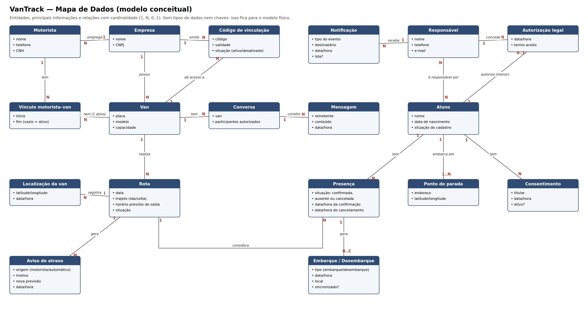

# Mapa de Dados — VanTrack (Revisado — E-07 / VT-65)

O mapa de dados apresenta as entidades do VanTrack e as relações entre
elas, escritas em linguagem natural e representadas em um diagrama
conceitual com as cardinalidades.

> **Revisão E-07 (VT-65):** atualizado conforme a implementação e o modelo
> físico (`supabase/migrations/001_base.sql` e `002_notificacao.sql`) e os pontos
> da seção 8 de [`../../desenvolvimento/03-arquitetura.md`](../../desenvolvimento/03-arquitetura.md).

---

## 1. Relações em linguagem natural

### Empresa, vans e motoristas

- Uma **Empresa** possui muitas **Vans**.
- Uma **Empresa** emprega muitos **Motoristas**.
- Uma **Empresa** emite muitos **Códigos de vinculação**, e cada código dá acesso a uma **Van**.
- Uma **Van** tem muitos **Vínculos de motorista** ao longo do tempo, mas **apenas um ativo por vez**.
- Um **Motorista** pode ter muitos **Vínculos** (histórico de quais vans dirigiu e quando).

### Identificação e acesso (apoio)

- **Motorista** e **Responsável** são **Usuários** do sistema (`login` único e `senha_hash` opcional na entrega simplificada).
- Um **Usuário** pode ter muitas **Sessões** (tokens de acesso ativos por aparelho/janela).

### Famílias e alunos

- Um **Responsável** pode ser responsável por muitos **Alunos**, e um **Aluno** pode ter muitos **Responsáveis**.
- Um **Aluno menor de idade** deve ter pelo menos um **Responsável** vinculado.
- Um **Aluno menor de idade** tem uma **Autorização legal**, concedida por um **Responsável**.
- Um **Aluno** tem um ou mais **Consentimentos** para uso da localização.
- Um **Aluno** embarca em um ou mais **Pontos de parada** (por exemplo, um na ida e outro na volta).

### Operação diária

- Uma **Van** realiza muitas **Rotas** (uma por dia e por trajeto: ida ou volta).
- Uma **Rota** passa por muitos **Pontos de parada**, em uma ordem definida.
- Um **Aluno** tem muitas **Presenças**, e cada **Presença** é de um aluno em uma **Rota**, ligada a um **Ponto de parada** e a uma **ordem** na rota.
- Uma **Presença** confirmada gera no máximo um **Embarque** (com identificador único `registro_id` para idempotência) e um **Desembarque**. Só existe desembarque se houve embarque na mesma rota.
- Quando o aparelho está sem conexão, os registros pendentes ficam guardados em uma fila local no dispositivo (`ArmazenamentoLocal`), e não como coluna no banco do servidor.
- Uma **Rota** registra muitas **Localizações da van** durante o trajeto.
- Uma **Rota** pode gerar muitos **Avisos de atraso** (manuais ou automáticos).

### Comunicação

- Um **Usuário** (responsável, aluno ou motorista) recebe muitas **Notificações**; cada notificação se refere a um evento (proximidade, embarque, desembarque, atraso ou cancelamento).
- Uma **Van** tem uma ou mais **Conversas**, das quais participam o motorista e os responsáveis/alunos vinculados.
- Uma **Conversa** contém muitas **Mensagens**, cada uma enviada por um participante.

---

## 2. Diagrama conceitual

*(Diagrama conceitual original do 1º bimestre; ver na seção 3 as atualizações de `Embarque` e `Sessão` aplicadas na entrega.)*

---

## 3. Entidades e principais informações

| Entidade | Principais informações | Por que existe |
|---|---|---|
| Empresa | nome, CNPJ | Dona das vans e emissora dos códigos (RN-001). |
| Código de vinculação | código, validade, situação | Controla o acesso à van (RF-001). |
| Usuário *(abstração)* | login, senha_hash? | Compartilha credenciais de acesso entre Motorista e Responsável. |
| Sessão *(apoio)* | token (UUID), papel, motorista/responsável, criada em | Mantém a autenticação por token Bearer para identificar quem faz a requisição (RN-002, RN-012). |
| Van | placa, modelo, capacidade | Veículo acompanhado pelas famílias. |
| Motorista | nome, login, telefone, CNH | Opera a van e registra embarques. |
| Vínculo motorista–van | início, fim | Garante um motorista ativo por vez e guarda o histórico (RN-012, RF-014). |
| Responsável | nome, login, telefone, e-mail | Acompanha o aluno e recebe os avisos. |
| Aluno | nome, data de nascimento, situação do cadastro | A data de nascimento define se é menor (RN-009, RN-016). |
| Autorização legal | data/hora, termo aceito | Exigida para ativar aluno menor (RN-016). |
| Consentimento | titular, data/hora, ativo? | Sem ele a localização não é compartilhada (RN-003). |
| Ponto de parada | endereço, latitude/longitude | Onde o aluno embarca/desembarca. |
| Rota | data, trajeto (ida/volta), horário previsto, situação | Percurso do dia, montado com os confirmados (RN-005). |
| Presença | ordem na rota, ponto de parada, situação, data/hora da confirmação, data/hora do cancelamento | Define quem entra na rota, a ordem da parada e respeita o prazo (RN-004, RN-006, RN-010). |
| Embarque / Desembarque | tipo, **registro_id (UUID único)**, data/hora do toque, localização opcional (latitude/longitude) | Registro do motorista com hora real do toque e idempotência na sincronização offline (RN-010, RN-011, RF-009, RNF-006). |
| Localização da van | latitude/longitude, data/hora | Acompanhamento em tempo real e aviso de proximidade (RF-002, RF-003). |
| Aviso de atraso | origem, motivo, nova previsão, data/hora | Comunicação única a todos os responsáveis (RN-014). |
| Notificação | tipo do evento, destinatário (responsável), aluno, mensagem, data/hora do evento, lida? | Evita avisos duplicados e registra o evento comunicado com a hora do embarque em UTC-3 (RF-011, UC-I02). |
| Conversa | van, participantes autorizados | Restringe o chat aos vinculados à van (RN-013). |
| Mensagem | remetente, conteúdo, data/hora | Histórico do chat (RF-013). |

---

## 4. O que mudou em relação à versão anterior

| Antes | Agora | Motivo |
|---|---|---|
| Modelo físico (PK, FK, Varchar) | Modelo conceitual com relações em frases | A etapa pede entidades e relações em linguagem natural. |
| Aluno com um único responsável | Responsável N:N Aluno | Um aluno pode ter mais de um responsável (RF-011, RN-009). |
| Van guardava só o motorista atual | Vínculo motorista–van com início e fim | Histórico de motoristas (RF-014, RN-012). |
| Sem código de vinculação | Entidade Código de vinculação | Acesso só por código da empresa (RF-001, RN-001). |
| Sem consentimento e autorização | Entidades Consentimento e Autorização legal | LGPD e dados de menores (RN-003, RN-016). |
| Check-in sem rota | Embarque/Desembarque ligado à Presença, que pertence a uma Rota | Desembarque só com embarque no mesmo trajeto (RN-011). |
| Presença só com data e status | Presença com trajeto, ordem da parada, ponto de parada e horários de confirmação/cancelamento | Prazo de 30 minutos, cancelamento e ordenação da tela Rota do dia (RN-004, RN-006, UC-S05). |
| Notificação só para responsável | Notificação para qualquer usuário; no UC-I02 guarda destinatário, aluno e mensagem montada | O motorista também é avisado (RF-006) e a consulta de avisos exibe o aluno e o texto do evento (RF-011). |
| Chat sem ligação com a van | Conversa pertence a uma Van | Acesso restrito por vínculo (RN-013). |
| `Embarque` com coluna `sincronizado?` e sem `registro_id` | **Removido `sincronizado?`** e **incluído `registro_id` (UUID único)** em `Embarque` (ponto 10, E-07) | No servidor todo embarque gravado já está sincronizado; a fila fica no aparelho (`ArmazenamentoLocal`). O `registro_id` garante idempotência no reenvio offline (`RNF-006`). |
| Sem entidade de autenticação no mapa | **Incluída entidade de apoio `Sessão`** (`token`, `papel`, vínculo com `Motorista`/`Responsável`) e abstração `Usuário` (E-07) | Necessária para identificar o usuário nas requisições protegidas (`RN-002` e `RN-012`). |
