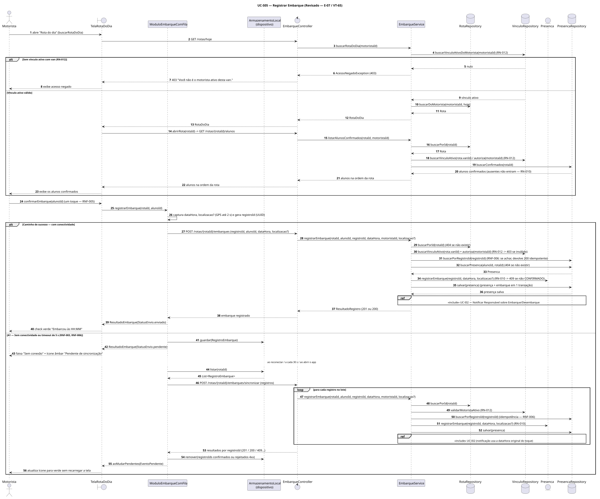
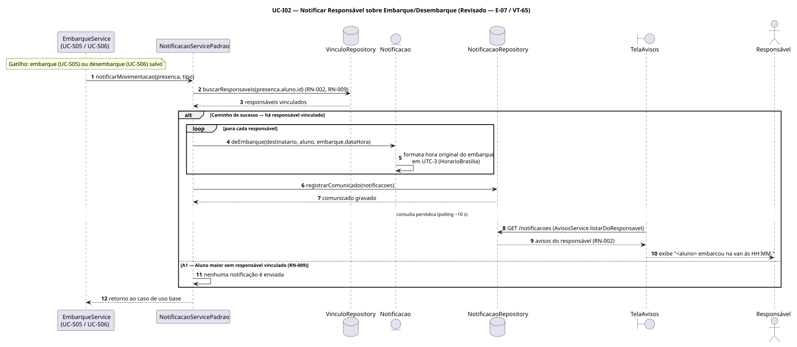
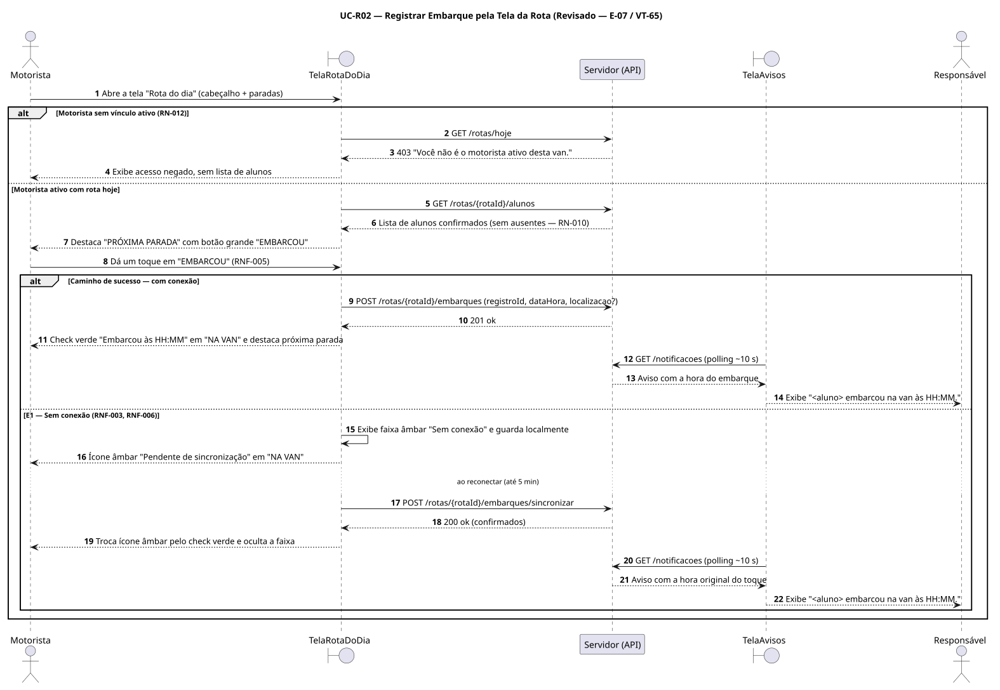

# Diagramas de Sequência — Revisão do Escopo Implementado (E-07 / VT-65)

Estes diagramas atualizam os scripts PlantUML da [atividade 04 original](https://github.com/luisgustavoribeirodefreitas/VanTrack/tree/main/documentos/atividade-04)
para o recorte implementado nesta entrega (**UC-S05 Registrar Embarque**, `<<include>>`
**UC-I02 Notificar Responsável** e **UC-R02 Registrar Embarque pela Tela da Rota**), mantendo
rastreabilidade exata com [`../../desenvolvimento/03-arquitetura.md`](../../desenvolvimento/03-arquitetura.md).

---

## O que mudou na revisão E-07 (VT-65)

| Diagrama | Alterações em relação ao 1º bimestre | Ponto (`03-arquitetura.md`) |
|---|---|---|
| **UC-S05** | Inclusão da abertura da rota (`GET /rotas/hoje`), validação do motorista ativo (`validarMotoristaAtivo` / `buscarVinculoAtivoDoMotorista` → **RN-012**), envio e passagem do `registroId` em `Presenca.registrarEmbarque(registroId, dataHora, localizacao?)`, verificação de idempotência (`buscarPorRegistroId`), execução via `ModuloEmbarqueComFila` e sincronização em lote (`POST .../sincronizar`). | Pontos **5**, **18** e **22** |
| **UC-I02** | `montarMensagem` deixou de ficar no `NotificacaoService` e passou para a fábrica `Notificacao.deEmbarque(...)` na entidade (horário de Brasília UTC-3 via `HorarioBrasilia`). O participante externo de push foi substituído pelo fluxo real de *polling* (~10 s) em `TelaAvisos` → `GET /notificacoes`. | Ponto **6** e Decisão **5** |
| **UC-R02** | Atualizado para refletir a tela real (`TelaRotaDoDia`, faixa âmbar `FaixaSemConexao`, validação 403 do motorista sem vínculo e consulta na `TelaAvisos` do responsável). | Pontos **18**, **19**, **22** e **RNF-003** |

---

## Responsabilidades atualizadas dos participantes principais

| Participante | Camada | Responsabilidade | Regras / Requisitos |
|---|---|---|---|
| `TelaRotaDoDia` | Apresentação (app) | Exibir a rota do dia, faixa `"Sem conexão"` e registrar embarque com um toque sem diálogo. | RN-010, RNF-003, RNF-004, RNF-005 |
| `ModuloEmbarqueComFila` | Aplicação (app) | Capturar `dataHora`, `localizacao?` (até 2 s) e `registroId`; enviar online ou enfileirar offline e sincronizar ao reconectar, a cada 30 s e ao abrir o app. | RF-009, RNF-005, RNF-006 |
| `ArmazenamentoLocal` | Infraestrutura (app) | Persistir a fila de `RegistroEmbarque` em JSON no `shared_preferences` (Android e Web). | RNF-006 |
| `EmbarqueController` | Apresentação (back-end) | Converter HTTP/JSON e exceções de domínio/aplicação (`403`, `404`, `409`, `200`, `201`). | RF-009, RNF-006 |
| `EmbarqueService` | Aplicação (back-end) | Coordenar o UC-S05: existência da rota, motorista ativo (`validarMotoristaAtivo`), idempotência (`buscarPorRegistroId`), chamada à `Presenca`, transação única e acionamento do `UC-I02`. | RN-010, RN-012, RF-009, RNF-006 |
| `VinculoMotoristaVan` / `VinculoRepository` | Domínio / Contrato | Verificar se há vínculo ativo autorizando o motorista (`RN-012`) e localizar responsáveis (`RN-002`, `RN-009`). | RN-002, RN-009, RN-012 |
| `Presenca` | Domínio (back-end) | Validar situação `CONFIRMADO` (`RN-010`), alterar para `EMBARCADO` e compor `Embarque` com `registroId`, `dataHora` e `localizacao?`. | RN-010, RF-009 |
| `NotificacaoServicePadrao` | Aplicação (back-end) | Coordenar o UC-I02: buscar responsáveis e registrar comunicado; retornar sem erro quando aluno maior não tem responsável (`A1`). | RN-002, RN-009, RF-011 |
| `Notificacao` | Domínio (back-end) | Fábrica `deEmbarque(...)` monta a mensagem com a hora do embarque em horário de Brasília (UTC-3), controla leitura e verifica titularidade (`pertenceA`). | RN-002, RF-011 |
| `TelaAvisos` | Apresentação (app) | Consultar `GET /notificacoes` e `GET /alunos` a cada ~10 s (*polling*), exibir avisos do responsável e marcar como lidos. | RN-002, RF-011, RNF-003 |

---

## Diagramas revisados

### UC-S05 — Registrar Embarque

Script fonte: [`scripts/UC-S05.puml`](scripts/UC-S05.puml) · [PNG](imagens/UC-S05.png)

### UC-I02 — Notificar Responsável sobre Embarque/Desembarque (`«include»`)

Script fonte: [`scripts/UC-I02.puml`](scripts/UC-I02.puml) · [PNG](imagens/UC-I02.png)

### UC-R02 — Registrar Embarque pela Tela da Rota (Real)

Script fonte: [`scripts/UC-R02.puml`](scripts/UC-R02.puml) · [PNG](imagens/UC-R02.png)
